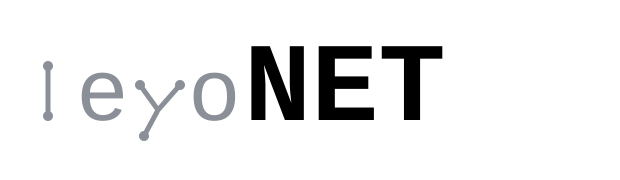
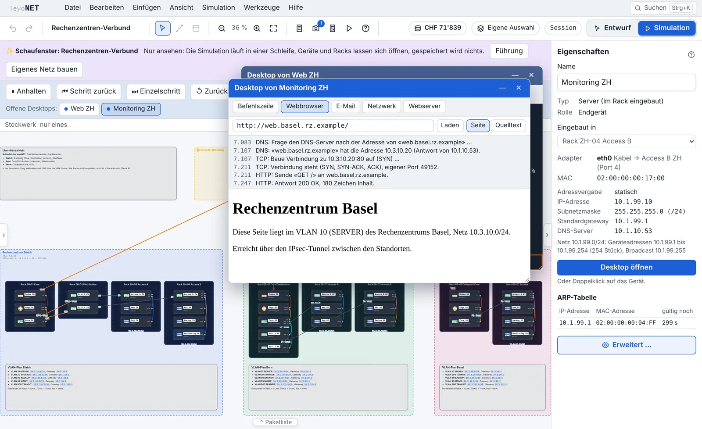
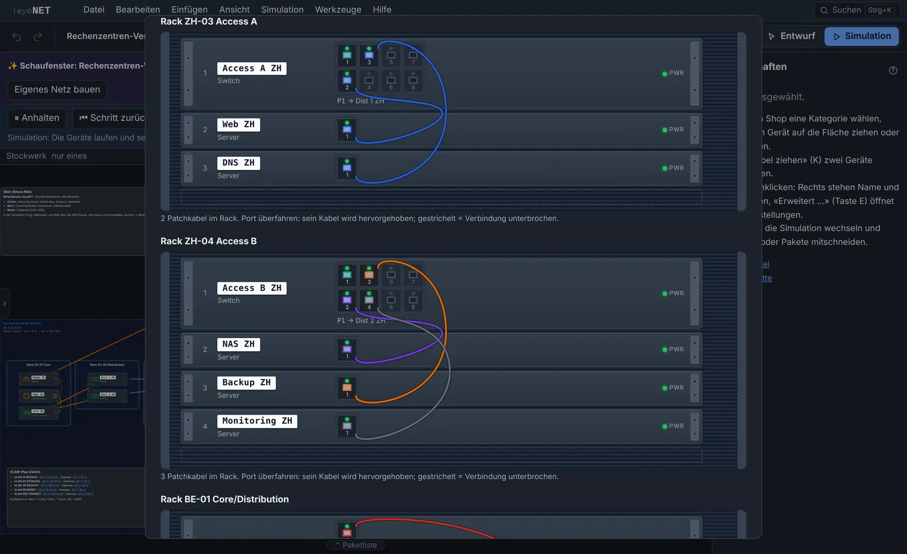
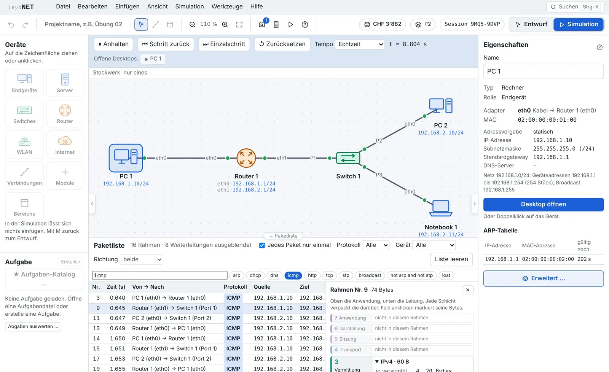
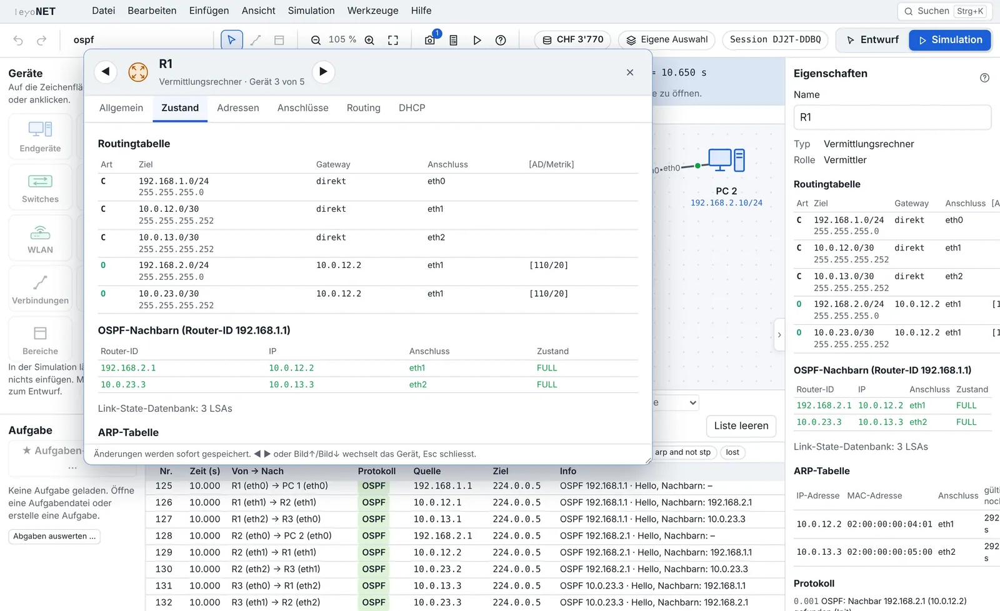
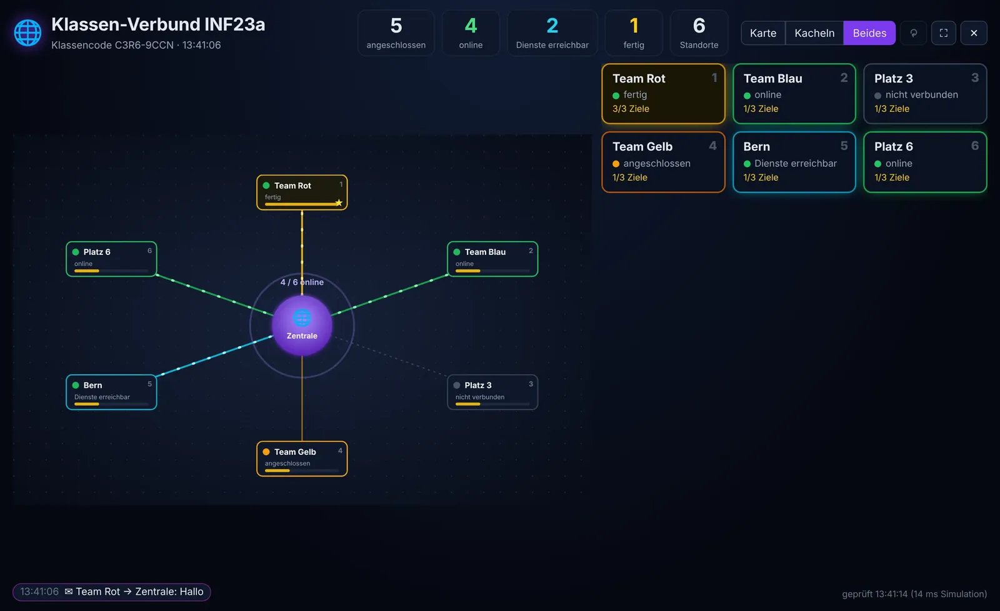
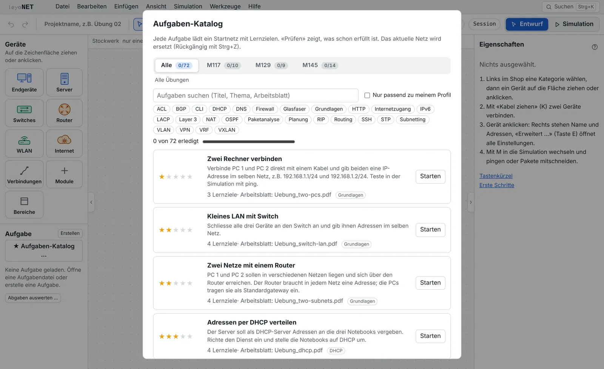
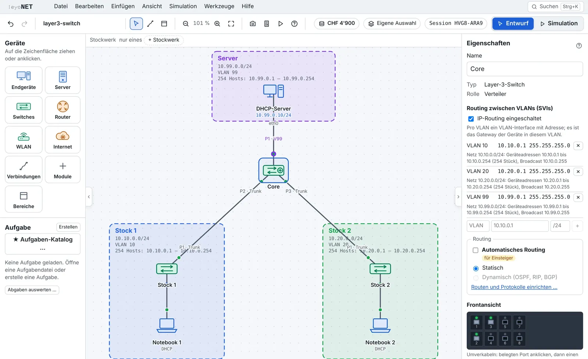
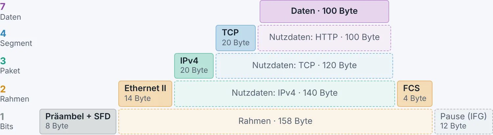

<p align="center"></p>

<p align="center"><strong>Netzwerke bauen, simulieren und verstehen.</strong><br />Ein Netzwerk-Simulator für den Informatik-Unterricht, vom ersten Lehrjahr bis zur Fachhochschule.</p>

<p align="center">
  <a href="https://app.leyonet.ch/"><strong>Im Browser starten</strong></a> ·
  <a href="https://app.leyonet.ch/?schaufenster">Live-Schaufenster</a> ·
  <a href="https://github.com/vonam-git/leyoNET/releases/latest">Herunterladen</a> ·
  <a href="https://leyonet.ch/wiki/">Wiki</a> ·
  <a href="https://leyonet.ch">leyonet.ch</a>
</p>

<p align="center">
  <a href="https://github.com/vonam-git/leyoNET/actions/workflows/ci.yml"></a>
  <a href="LICENSE"></a>
  
</p>

<picture>
  <source media="(prefers-color-scheme: dark)" srcset="docs/bilder/schaufenster-dark.webp" />
  
</picture>

<p align="center"><sub>Das <a href="https://app.leyonet.ch/?schaufenster">Schaufenster</a>: drei Rechenzentren mit Core, Distribution und Access, angeschlossen über Glasfaser, Kabel und VDSL, verbunden mit IPsec. Läuft live, nur zum Ansehen.</sub></p>

## Was leyoNET kann

Geräte aus dem Shop ziehen, verkabeln, konfigurieren – und dann zusehen, wie jedes Paket über die Leitung geht. Vom ersten ARP bis zum BGP-Update, in echten Bytes nach Norm.

<table>
  <tr>
    <td width="50%"><br /><strong>Racks und Frontplatten</strong><br />Geräte als Einschübe, Ports in der Farbe ihres VLANs, Patchkabel, SFP-Module und Link-LEDs.</td>
    <td width="50%"><br /><strong>Pakete wie in Wireshark</strong><br />Paketliste mit OSI-Schichten, Hex-Ansicht, Filtern (<code>icmp and ip.dst == …</code>) und pcapng-Export.</td>
  </tr>
  <tr>
    <td><br /><strong>Geräte wie echt konfigurieren</strong><br />Formulare mit Reitern oder Befehlszeile im Stil von FRRouting und Cisco IOS, mit <code>?</code>, Tab und SSH.</td>
    <td><br /><strong>Klassen-Verbund mit Dashboard</strong><br />Jede Gruppe baut einen Standort, alle hängen an einer Infrastruktur. Der Beamer zeigt live, wer online ist.</td>
  </tr>
  <tr>
    <td><br /><strong>Über 70 Übungen, die sich selbst prüfen</strong><br />Von ★ bis ★★★★★, mit Arbeitsblatt (PDF) und Reihen für die Module 117, 129 und 145.</td>
    <td><br /><strong>Sauber dokumentiert</strong><br />Bereiche mit Netz und VLAN, Notizen, Stockwerke, Snapshots und Richtpreise in CHF.</td>
  </tr>
  <tr>
    <td colspan="2"><picture><source media="(prefers-color-scheme: dark)" srcset="docs/bilder/aufbau-dark.webp" /></picture><br /><strong>Rahmen und Pakete nach Norm</strong><br />Jeder Kopf als Bild wie in RFC und IEEE-Norm, mit den Werten des angeklickten Rahmens, dazu die Verschachtelung bis zur FCS. Gleich im <a href="https://leyonet.ch/wiki/rahmen-und-pakete.html">Wiki</a>.</td>
  </tr>
</table>

## Für den Unterricht

- **Fünf Funktionsprofile** vom 1. Lehrjahr (PC, Switch, Router, DHCP) bis zum Studium (BGP, VRF, VXLAN). Wer nur das Nötige sieht, verliert sich nicht.
- **Demos zu jedem Protokoll**, viele mit Führung Schritt für Schritt – vorführen per Knopfdruck.
- **Prüfungen** mit Punkten und Schweizer Note, Variante je Platz, Nachteilsausgleich, Safe Exam Browser und automatischer Auswertung.
- **Klassen-Verbund** und **Ansehen**: Lehrpersonen schauen jeder Session zu, ohne etwas zu verändern.
- **Webversion für die Schule** mit Klassen, eigenen Zugängen für Schulen und Lehrpersonen, Aufgaben ein- und ausblenden.
- **Crashkurs und Theorie** im [Wiki](https://leyonet.ch/wiki/): für Lehrpersonen der Einstieg in 30 Minuten, für Lernende jedes Gerät und Protokoll mit Beispiel und Norm.

## Technisch ernst gemeint

| | |
|---|---|
| **Protokolle** | Ethernet, ARP, VLAN (802.1Q), STP, LACP, WLAN mit WPA2 · IPv4, IPv6 mit SLAAC und DHCPv6, ICMP, NAT/PAT, CGNAT, DS-Lite · statisch, OSPFv2/v3, RIP/RIPng, BGP-4, VRF, VXLAN · TCP, UDP · DHCP, DNS, HTTP, SMTP, POP3, IMAP, SSH · Firewall, ACL, IPsec (IKEv2, ESP) · DOCSIS, GPON, VDSL, LTE, PPP |
| **Echte Bytes** | Jeder Rahmen wird nach Norm kodiert; der Export öffnet sich in Wireshark. 65 zitierte Normen (RFC, IEEE, ITU-T) stehen in einem Verzeichnis, das wöchentlich mit dem RFC-Index abgeglichen wird. |
| **Wiederholbar** | Diskrete Ereignis-Simulation: derselbe Ablauf ergibt immer dieselbe Paketfolge. Darum lässt sich jede Demo und jede Musterlösung automatisch prüfen. |
| **Geprüft** | Über 680 Tests des Kerns, Server-Tests, Oberflächentests und über 100 automatische Angriffe bei jedem Release. |
| **Überall** | Eine einzige HTML-Datei (läuft offline, auch vom USB-Stick), Webversion mit Node.js ohne Abhängigkeiten, Desktop für Windows, macOS und Linux. Deutsch und Englisch, hell und dunkel. |
| **Datenschutz** | Keine Konten, keine Cookies, kein Tracking, keine externen Ressourcen. Die Einzeldatei kann technisch keine Verbindung aufbauen (CSP `connect-src 'none'`). |

## Loslegen

- **Im Browser:** [app.leyonet.ch](https://app.leyonet.ch) – sofort, ohne Installation.
- **Eine Datei:** [`leyonet.html`](https://github.com/vonam-git/leyoNET/releases/latest/download/leyonet.html) herunterladen und doppelklicken.
- **Installieren:** Windows, macOS und Linux unter [Releases](https://github.com/vonam-git/leyoNET/releases/latest).
- **Eigener Schulserver:** [Installation](docs/installation.md) mit Docker oder [Plesk](docs/plesk.md).

## Dokumentation

**Lernende:** [Anleitung](docs/anleitung.md) · [Befehlszeile](docs/cli.md) · [Wiki](https://leyonet.ch/wiki/)<br />
**Lehrpersonen:** [Hinweise](docs/lehrpersonen.md) · [Funktionsprofile](docs/funktionsprofile.md) · [Aufgaben erstellen](docs/aufgaben.md) · [Prüfungen](docs/pruefungen.md) · [Klassen-Verbund](docs/verbund.md)<br />
**Technik:** [Alle Funktionen](docs/funktionen.md) · [Protokolle und Vereinfachungen](docs/protokolle.md) · [Normen](docs/normen.md) · [Entwicklung](docs/entwicklung.md) · [Versionen](docs/versionen.md)<br />
**Schulen:** [Datenschutz](docs/datenschutz.md) · [IT-Sicherheit](docs/sicherheit.md) · [ISDS-Konzept](docs/isds-konzept.md) · [DSFA-Abklärung](docs/dsfa-abklaerung.md) · [Desktop](docs/desktop.md)

## Mitentwickeln

```bash
npm ci
npm run dev       # http://localhost:5173/dev.html
npm run release   # Typprüfung, Tests, Build, release/leyonet.html (vor jedem Commit)
```

Aufbau, Regeln und alle Befehle: [docs/entwicklung.md](docs/entwicklung.md). Gearbeitet wird auf `develop`, `main` ist die stabile Version.

## Geschichte

Mark unterrichtet Netzwerktechnik. Nach Jahren mit anderen Simulatoren wollte er ein Werkzeug, das moderner ist, mehr kann, im Browser läuft und sich trotzdem lokal installieren lässt. Das Grundgerüst baute er mit seinem Bruder Mika; seither kommt jede Idee aus dem Unterricht dazu. Programmiert wird mit Hilfe künstlicher Intelligenz – Ideen, Erfahrung und Verantwortung liegen bei Mark und Mika. «leyo» sind die Anfangsbuchstaben von Marks Kindern; das Symbol zeigt ein «l» und ein «y» aus Netzwerkknoten: «ly» für «love you».

leyoNET ist eine eigenständige Neuentwicklung ohne fremden Code, fremde Grafiken oder Texte ([Herkunft](docs/herkunft.md)).

## Unterstützen

leyoNET ist und bleibt kostenlos. Wer die Weiterentwicklung unterstützen möchte, kann das freiwillig über [Patreon](https://www.patreon.com/cw/vonam) tun.

## Lizenz

© 2026 Mark v. A. und Mikael v. A. – freie Software unter der [GNU Affero General Public License v3 oder neuer](LICENSE). Schulen dürfen leyoNET frei nutzen, kopieren und auf dem eigenen Server betreiben; wer es verändert und weitergibt oder als Webdienst anbietet, legt den Quellcode offen. **Name und Logo** sind nicht Teil der Lizenz ([NOTICE.md](NOTICE.md)). Versionen bis 0.4.0 (damals «Netzwerk-Simulator») erschienen unter MIT. Lizenzen eingebauter Software: [release/THIRD_PARTY_NOTICES.md](release/THIRD_PARTY_NOTICES.md).
