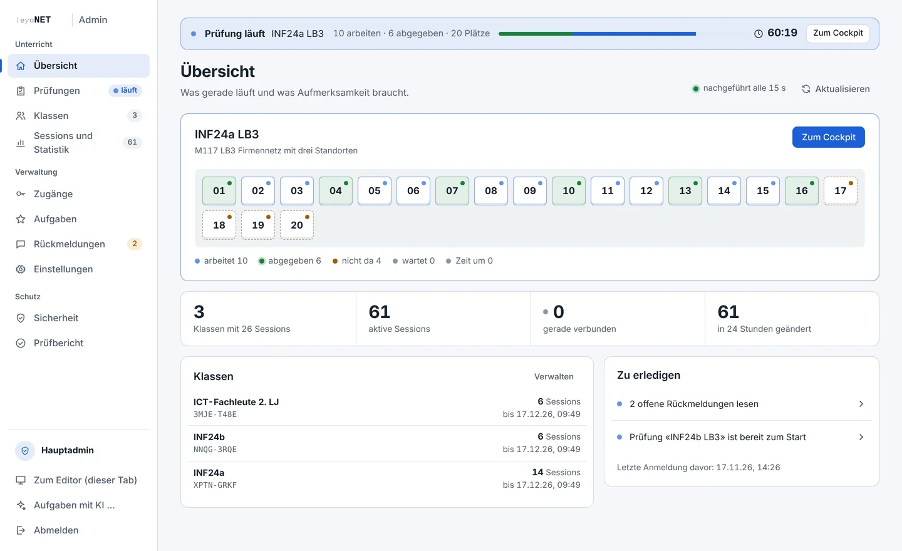

# Webversion auf Plesk (Node.js)

Der Branch `develop` ist der Entwicklungsstand. Plesk holt ihn von GitHub und startet den kleinen Node.js-Server aus `server/`. Er liefert die fertige Datei `release/leyonet.html` aus und bietet zusätzlich Sessions mit Code, Klassen-Sessions, Rückmeldungen und die Admin-Konsole. Auf dem Server wird nichts gebaut, und es werden keine npm-Pakete installiert: Der Server nutzt nur Node.js-Bordmittel.

```
Rechner (du)  ──git push──►  GitHub: develop  ──Plesk Git (Pull)──►  simulator-test.deine-domain.ch
                                                                      └─ Node.js: server/start.cjs (Anwendungsstamm httpdocs/server)
```

## Einmalig einrichten

1. **Subdomain anlegen**, z.B. `simulator-test.deine-domain.ch` (Websites & Domains → Subdomain hinzufügen).
2. **Git hinzufügen**: bei der Subdomain auf **Git** klicken.
   - Repository: **Remote-Git-Hosting**
   - URL: `https://github.com/vonam-git/leyoNET.git`
     (bei einem privaten Repository die SSH-URL `git@github.com:vonam-git/leyoNET.git` und den von Plesk angezeigten SSH-Schlüssel auf GitHub unter *Settings → Deploy keys* eintragen, nur Lesezugriff)
   - Bereitstellungsmodus: **Automatisch**
   - Serverpfad: **`/httpdocs`** (nicht der Dokumentstamm `/httpdocs/server/public`: sonst landet das ganze Repository im öffentlichen Ordner)
   - Nach dem Anlegen in den Git-Einstellungen den **Branch auf `develop`** stellen.
   - Unter **Zusätzliche Bereitstellungsaktionen** eintragen, damit der Server nach jedem Pull neu startet:
     ```
     mkdir -p server/tmp && touch server/tmp/restart.txt
     ```
3. **Node.js aktivieren** (bei der Subdomain auf **Node.js**):
   - Node.js-Version: **22 oder neuer** (die neueste LTS; ältere Versionen erhalten keine Sicherheitsupdates mehr)
   - Anwendungsmodus: `production`
   - Anwendungsstamm: **`/httpdocs/server`** (dort liegt eine eigene `package.json` ohne Abhängigkeiten; im Hauptordner würde Plesk ab Version 18.0.81 wegen Vite eine «statische» App erkennen und den Node-Server nicht starten)
   - Dokumentstamm: `/httpdocs/server/public` (absichtlich leer, so ist der Quellcode nicht direkt erreichbar)
   - Anwendungsstartdatei: `start.cjs`
   - Zeigt das Dashboard danach als Anwendungstyp «Statisch (Vite)», Node.js einmal deaktivieren und mit diesen Werten wieder aktivieren, damit Plesk neu erkennt.
   - **Benutzerdefinierte Umgebungsvariablen**:
     | Name | Wert | Zweck |
     |---|---|---|
     | `ADMIN_PASSWORD` | ein langes, zufälliges Passwort | öffnet die Admin-Konsole; ohne diese Variable ist sie gesperrt |
     | `DATA_DIR` | optional, z.B. `/var/www/vhosts/deine-domain.ch/simulator-data` | Ablage der Sessions, Klassen und Prüfungen. **Empfohlen: ein Ordner ausserhalb von `httpdocs`**, damit die Daten auch bei falsch gesetztem Dokumentstamm nie abrufbar sind (die `.htaccess` im Datenordner wirkt nur mit Apache, nicht wenn nginx Dateien direkt ausliefert). Standard ist `httpdocs/data`; der Server meldet das beim Start als Hinweis. Umziehen: App stoppen, Ordner verschieben, `DATA_DIR` setzen, App starten |
     | `MAX_SESSIONS` | optional, Standard `5000` | höchstens so viele Sessions gleichzeitig (Schutz vor Überlastung) |
     | `LEYONET_CHANNEL` | nur für die Testumgebung: `beta` | zeigt oben «Testversion» und hält Suchmaschinen fern (`noindex`, `robots.txt`) |
     | `MAX_STORAGE_MB` | optional, Standard `1024` | höchstens so viel Platz für Sessions und Rückmeldungen; Prüfungen sind ausgenommen |
     | `STATS_ORIGINS` | optional, Standard `https://leyonet.ch,https://www.leyonet.ch` | Adressen der Website, deren anonyme Besucherzählung dieser Server annimmt (Admin-Konsole → *Website und Downloads*). Auf beta leer setzen (`STATS_ORIGINS=` ohne Wert), dann zählt nur app.leyonet.ch |
     | `STATS_GITHUB_REPO` | optional, Standard `vonam-git/leyoNET`; `off` schaltet ab | Repository, dessen Download-Zähler die Admin-Konsole zeigt (öffentliche GitHub-Schnittstelle, höchstens einmal pro Stunde; der Server braucht dafür ausgehend HTTPS zu `api.github.com`) |
     | `ADMIN_MFA_RESET` | nur im Notfall: `1` | schaltet beim Start die Zwei-Faktor-Anmeldung des Hauptadmins aus (Handy und Wiederherstellungscodes verloren); danach Variable wieder entfernen und App neu starten |
   - *NPM install* ist nicht nötig. Auf **Node.js aktivieren** bzw. **App neu starten** klicken.
4. **SSL/TLS** für die Subdomain aktivieren (Let's Encrypt in Plesk) und *Permanente SEO-sichere 301-Weiterleitung von HTTP zu HTTPS* einschalten.
5. **Zugriffsprotokolle** (Datenschutz): Plesk speichert standardmässig IP-Adressen im Access-Log des Webservers. Unter *Protokolle → Protokollrotation* die Aufbewahrung auf wenige Tage begrenzen oder die Protokollierung für die Subdomain abschalten (siehe [datenschutz.md](datenschutz.md#webserver-protokolle)).

Danach unter der Adresse der Subdomain den Simulator öffnen. Oben rechts erscheint der Session-Code. Die Admin-Konsole ist eine eigene Seite: **`https://<subdomain>/admin`** (oder «Admin» bzw. Alt+A im Simulator, öffnet sie in einem eigenen Tab).

## Admin-Konsole

Die Konsole läuft unter **`/admin`** in einem eigenen Tab und bleibt neben dem Unterricht offen. Links stehen die Bereiche, oben eine rote Leiste, solange eine Prüfung läuft (wer arbeitet, wer abgegeben hat, Restzeit, «Zum Cockpit»). Was den Editor braucht (Session öffnen oder live ansehen, Infrastruktur bearbeiten, Aufgaben mit KI), wechselt im selben Tab zum Editor; «Zurück zur Admin-Konsole» führt zurück. Im Admin-Tab wird nichts als Session gespeichert.



- **Übersicht**: Läuft eine Prüfung, zeigt ein Patchfeld jeden Platz mit Leuchte (arbeitet, abgegeben, nicht da, wartet, Zeit um). Darunter Kennzahlen, die Klassen und «Zu erledigen» (z.B. Zwei-Faktor einrichten, offene Rückmeldungen, bereite Prüfungen); alles wird alle 15 Sekunden nachgeführt. Die Seitenleiste gliedert die Bereiche in Unterricht, Verwaltung und Schutz.
- **Anmeldung**: mit dem Admin-Passwort (Hauptadmin) oder mit einem **Zugangsschlüssel** `LN-…` (Schule oder Lehrperson) im selben Feld, danach gegebenenfalls der Code aus der Authenticator-App. Das Token liegt nur im `sessionStorage` dieses Tabs (überlebt ein Neuladen, endet mit dem Tab, nie ein Cookie). Nach 60 Minuten ohne Anfrage meldet der Server ab.
- **Sessions und Statistik**: Kennzahlen (aktiv, gerade verbunden, in 24 Stunden geändert, neu, Speicher, Anteil einzeln / Klasse / Prüfung) und die Liste aller aktiven Sessions mit Filter und Suche. Je Session: live ansehen, im Editor öffnen, um einen oder sieben Tage verlängern (höchstens 60 Tage ab heute) oder löschen. Prüfungsplätze lassen sich nur ansehen; sie gelten so lange wie die Prüfung. Zugänge sehen nur Sessions ihrer Klassen und Prüfungen. Nur technische Angaben, keine Inhalte.
- **Sicherheit**: Zwei-Faktor-Anmeldung mit einer Authenticator-App (TOTP nach RFC 6238 mit HOTP nach RFC 4226): QR-Code scannen oder Schlüssel eintippen, mit einem Code bestätigen, acht Wiederherstellungscodes sicher aufbewahren. Der Hauptadmin kann Zwei-Faktor **für alle Zugänge verlangen** (erst nachdem er ihn selbst eingerichtet hat); Zugänge ohne zweiten Faktor sehen dann nur die Einrichtung. Dazu: letzte Anmeldung, offene Anmeldungen, «Alle anderen Anmeldungen beenden». Handy verloren: Wiederherstellungscode; bei Zugängen setzt der Hauptadmin bzw. die Schule unter «Zugänge» zurück; beim Hauptadmin einmal mit `ADMIN_MFA_RESET=1` starten und die Variable danach wieder entfernen. Das Geheimnis ist mit dem Admin-Passwort verschlüsselt: Nach einem Wechsel von `ADMIN_PASSWORD` gelten nur noch die Wiederherstellungscodes (danach neu einrichten).
- **Klassen**: Klassen-Sessions eröffnen (nur eine Bezeichnung wie «INF22a», keine Namen), den Klassencode verteilen, die Arbeiten der Klasse öffnen und die Klasse schliessen. Bei jeder Klasse: **Klassen-Verbund** freigeben, Infrastruktur setzen, **Dashboard** für den Beamer öffnen und Aufgaben für die Klasse ein- und ausblenden (siehe [verbund.md](verbund.md)).
- **Zugänge** (Hauptadmin und Schulen): eigene Zugänge für Schulen und Lehrpersonen mit einer Bezeichnung ohne Personenbezug. Der Schlüssel erscheint nur einmal; gespeichert ist nur eine Prüfsumme. Jeder Zugang sieht nur seine Klassen und Prüfungen, eine Schule auch die ihrer Lehrpersonen. Einstellungen, Aufgaben (global), Rückmeldungen und Systemprüfung bleiben beim Hauptadmin. Gespeichert unter `DATA_DIR/tenants`.
- **Aufgaben** (Hauptadmin): Übungen, ganze Reihen (Module) und die Verbund-Aufgaben für die ganze Instanz ein- und ausblenden.
- **Klassen**: Beim Eröffnen wählt man, wie viele Tage der Klassencode gilt (Vorgabe aus den Einstellungen, höchstens 180). In der Liste verlängern «+7 Tage» und «+30 Tage» den Code, höchstens bis 180 Tage ab heute.
- **Schneller Zugang**: In der Werkzeugleiste steht «Admin» (Tastenkürzel Alt+A). Die Schaltfläche öffnet `/admin` in einem eigenen Tab bzw. holt ihn nach vorne. Passwort und Token liegen nie im `localStorage` oder in Cookies, und in einer Prüfung ist die Schaltfläche ausgeblendet; auf einem Gerät im Prüfungsmodus ist auch `/admin` gesperrt.
- **Prüfungen**: Prüfungsdatei und Schlüssel hochladen (die **Prüfungszeit ist Pflicht**), Prüfungsblätter (je Platz Code und Auftrag) oder Platzkarten drucken, Code zum Beenden anzeigen, starten, Nachteilsausgleich je Platz, beenden, automatisch auswerten, Abgaben herunterladen; je Platz steht «abgegeben 10:42», sobald die Person abgegeben hat (siehe [pruefungen.md](pruefungen.md#prüfung-in-der-webversion-server)). Gespeichert wird unter `DATA_DIR/exams`, gelöscht nach 60 Tagen. Der Schlüssel ist mit dem Admin-Passwort verschlüsselt: **Admin-Passwort nicht während laufender Prüfungen ändern.**
- **Rückmeldungen** (Hauptadmin): Probleme und Ideen der Lernenden, mit Status *neu / in Arbeit / erledigt*.
- **Einstellungen**:
  - erlaubte Modi (Entwurf, Simulation)
  - **Standardprofil** und **höchstes Profil** (1 = 1. Lehrjahr … 5 = Studium) sowie einzelne **gesperrte Funktionen** (siehe [funktionsprofile.md](funktionsprofile.md))
  - Aufbewahrung von Sessions, Klassen und Rückmeldungen, Rückmeldungen ein/aus
  - belegter Speicher und Anzahl Sessions im Vergleich zur Grenze (Warnung ab 80 %)
- **Systemprüfung**: Ergebnis der Release-Prüfung (Datenschutz, Sicherheit, Lizenzen) der ausgelieferten Version aus `release/checks.json` (siehe [datenschutz.md](datenschutz.md#prüfung-bei-jedem-release)).

Ältere Einstellungen (Aktions- und Dokumentationsmodus, Pro-Version) werden beim ersten Start automatisch übernommen: «Pro aus» wird zu höchstem Profil 3.

In der lokalen HTML-Datei und in der Desktop-Version gibt es keinen Server; dort ist die Admin-Konsole ausgegraut und alles erlaubt. Lehrpersonen steuern den Funktionsumfang dort mit einer Funktionsdatei.

## Automatisch aktualisieren nach jedem Push

In Plesk unter *Git → Repository-Einstellungen* steht eine **Webhook-URL**. Diese auf GitHub eintragen:

*Repository → Settings → Webhooks → Add webhook*
- Payload URL: die Webhook-URL aus Plesk
- Content type: `application/json`
- Events: *Just the push event*

Ohne Webhook in Plesk einfach auf **Pull Updates** klicken (und, falls keine Bereitstellungsaktion eingetragen ist, auf **App neu starten**).

## Fehlersuche

- **Quelldateien sind öffentlich abrufbar oder `/` zeigt nicht den Simulator:** Unter *Git* prüfen, dass der **Serverpfad** `/httpdocs` ist. Steht dort `/httpdocs/server/public`, wird das Repository in den öffentlichen Ordner kopiert. Korrigieren, die Dateien unter `httpdocs/server/public` ausser `README.txt` löschen, *Pull Updates*, *App neu starten*.

- **Dashboard zeigt «Anwendungstyp: Statisch (Vite)», Status inaktiv:** Plesk hat die `package.json` im Hauptordner gelesen und hält das Projekt für eine statische Vite-Seite. Anwendungsstamm auf `/httpdocs/server` und Startdatei auf `start.cjs` stellen (siehe oben), Node.js deaktivieren und wieder aktivieren.

- **Konsole meldet `…/src/main.ts` mit falschem MIME-Typ** (ältere Stände): Seit v0.4 heisst die Quell-HTML `dev.html`, damit ein Webserver sie nie als Startseite ausliefert. Tritt die Meldung trotzdem auf: Der Webserver liefert die Quelldatei `index.html` aus dem Repository-Ordner aus statt der Node-App. Der **Dokumentstamm** steht falsch (meist auf `/httpdocs`). Unter *Node.js* den Dokumentstamm auf `/httpdocs/server/public` setzen und *App neu starten*. Wichtig auch für den Datenschutz: Mit `/httpdocs` als Dokumentstamm wären Quellcode und Datenordner direkt abrufbar. Der Server legt im Datenordner deshalb zusätzlich eine `.htaccess` an, die jeden Zugriff verbietet.

- **Weisse Seite oder «Wird geladen …» bleibt stehen:** Das Programm startet im Browser nicht. Browser-Konsole öffnen (F12). Steht dort «Refused to execute … Content-Security-Policy», setzt das Hosting eine eigene, strengere Richtlinie. Der Node-Server liefert Skripte und Stile deshalb als eigene Dateien unter `/assets/…` aus (keine Inline-Skripte), damit die Seite auch dann läuft. Eine zusätzliche Richtlinie unter *Apache & nginx-Einstellungen* sollte trotzdem entfernt werden.
- **`/healthz` antwortet nicht mit `ok`:** Die Node.js-App läuft nicht. Unter *Node.js* Anwendungsstamm `/httpdocs/server`, Startdatei `start.cjs` und Dokumentstamm `/httpdocs/server/public` prüfen, dann *App neu starten*; Fehler stehen unter *Protokolle anzeigen*.
- **Alter Stand:** *Git → Pull Updates*, danach *App neu starten*.

## Ablauf im Alltag

```bash
git switch develop
git pull                 # Stand von GitHub holen
# … ändern …
npm run release          # Tests, Build, release/leyonet.html neu erzeugen
npm run test:server      # Server-Tests
git add -A
git commit -m "Was geändert wurde"
git push                 # Plesk zieht den neuen Stand
```

Wichtig: Der Server liefert die **eingecheckte** Datei `release/leyonet.html` aus. Ohne `npm run release` vor dem Commit bleibt die Webversion auf dem alten Stand. Die CI auf GitHub meldet das mit einem roten Kreuz.

Lokal lässt sich die Webversion so ausprobieren:

```bash
ADMIN_PASSWORD=test npm run server     # http://localhost:3000
```

## Stabile Version

Ist der Stand auf `develop` gut, wird er nach `main` übernommen (Pull Request auf GitHub oder lokal `git switch main && git merge develop && git push`). Eine zweite Subdomain kann auf gleiche Weise den Branch `main` ausliefern; jede Subdomain hat ihre eigenen Sessions und ihr eigenes Admin-Passwort.

## leyonet.ch: Auftritt und Programm

- **leyonet.ch** (Hauptdomain): der Auftritt mit Übersicht und Downloads, reine statische Dateien im Ordner [`website/`](../website/), kein Node.js. Siehe [unten](#website-leyonetch).
- **app.leyonet.ch** (Subdomain): das Programm wie oben beschrieben, mit Branch **`main`** (stabile Version für Klassen und Prüfungen).
- **beta.leyonet.ch** mit Branch `develop` als Testumgebung: Umgebungsvariable `LEYONET_CHANNEL=beta`, eigenes `ADMIN_PASSWORD` und eigenes `DATA_DIR`. Oben steht dann «Testversion», und Suchmaschinen nehmen die Seite nicht auf. Keine Prüfungen auf beta durchführen: Nach einem Push kann dort etwas vorübergehend nicht funktionieren.
- Ablauf: auf beta testen; läuft es, Pull Request `develop` → `main`, dann bei app.leyonet.ch *Pull Updates*.
- Für jede Subdomain SSL/TLS mit Let's Encrypt aktivieren (oder ein Wildcard-Zertifikat für `*.leyonet.ch`).

## Website leyonet.ch

Die Website liegt im Repo unter [`website/httpdocs/`](../website/httpdocs/) (Startseite, Impressum, Datenschutz, Bilder, `.htaccess` mit Sicherheits-Köpfen; nur eigene Dateien, keine fremden Dienste). Die Downloads sind **Links auf GitHub-Releases** mit festen Dateinamen, z.B. `https://github.com/vonam-git/leyoNET/releases/latest/download/leyoNET-Windows-Setup.exe`. Bei einer neuen Version wird nichts hochgeladen: Sobald der Release veröffentlicht ist, zeigen die Links auf die neuen Dateien. Die festen Namen legt der Workflow `desktop.yml` (Auftrag «dateinamen») an.

Einrichten in Plesk und Ablauf bei neuen Versionen: [`website/ANLEITUNG.md`](../website/ANLEITUNG.md). Kurz: bei leyonet.ch *Git* mit Branch `main` und Bereitstellungspfad `leyonet-repo`, Dokumentstamm `leyonet-repo/website/httpdocs`. **Wichtig:** Weil nginx die statischen Dateien direkt ausliefert, gelten die Sicherheits-Köpfe der `.htaccess` nicht; sie gehören unter *Apache & nginx → Zusätzliche nginx-Anweisungen* (Abschnitt «Sicherheits-Köpfe für nginx» in der Anleitung). Für app. und beta. dort `server_tokens off;` und `passenger_show_version_in_header off;`.

## Ohne Node.js (nur statisch)

Bietet das Hosting kein Node.js, kann die Datei auch rein statisch ausgeliefert werden: Dokumentstamm auf `httpdocs/release` setzen; `release/.htaccess` öffnet den Simulator ohne Dateinamen und setzt die Sicherheits-Header. Sessions, Klassen, Rückmeldungen und Admin-Konsole gibt es dann nicht; die Seite verhält sich wie die lokale Datei.

Plesk mit **reinem Nginx** (ohne Apache) liest `.htaccess` nicht. Dann unter *Apache & nginx-Einstellungen → Zusätzliche nginx-Anweisungen* eintragen:
```
index leyonet.html;
add_header Content-Security-Policy "default-src 'none'; script-src 'unsafe-inline'; style-src 'unsafe-inline'; img-src data: blob:; connect-src 'none'; form-action 'none'; base-uri 'none'; frame-ancestors 'none'" always;
```

## Sicherung und Löschung

- Alle Daten liegen als JSON-Dateien in `DATA_DIR` (`sessions/`, `classes/`, `feedback/`, `settings.json`). Abgelaufene Einträge löscht der Server selbständig (beim Start und danach regelmässig).
- Während einer Prüfung speichern alle Plätze alle 20 Sekunden. Ganze Klassen hinter einer Schuladresse (NAT) sind eingeplant (bis 600 Speicherungen pro Minute und Adresse).
- Angriffe und Schutzmassnahmen der Webversion: [sicherheit.md](sicherheit.md). Ein langes, zufälliges `ADMIN_PASSWORD` (mindestens 12 Zeichen) und HTTPS sind Pflicht.
- Eine Sicherung ist nicht nötig und aus Datenschutzsicht auch nicht erwünscht: Sessions sind kurzlebige Arbeitsstände. Wer `DATA_DIR` trotzdem sichert, muss die Sicherungen ebenso kurz aufbewahren.
- Alles sofort löschen: App stoppen, Ordner `DATA_DIR` leeren, App starten.
