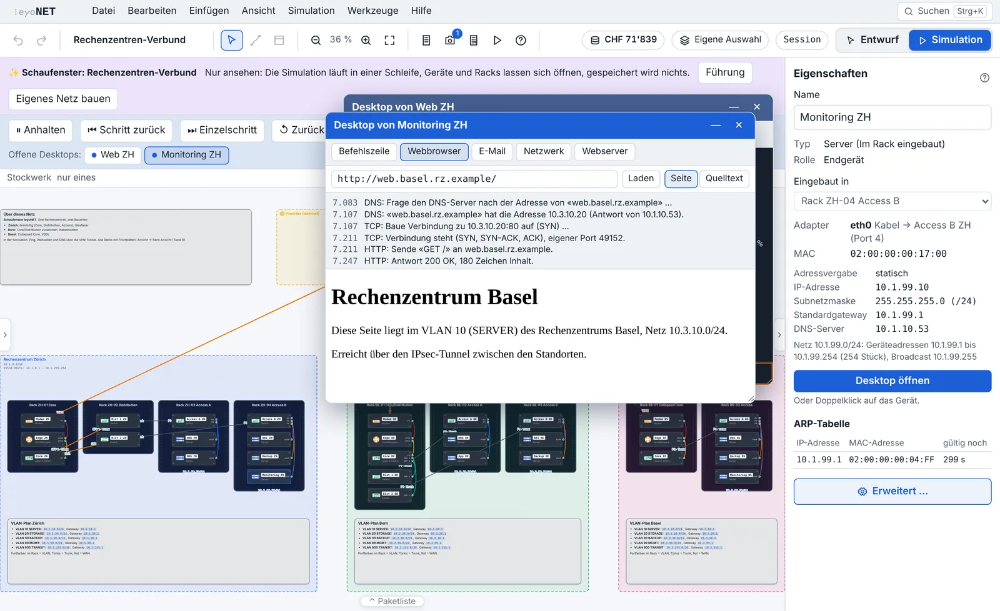
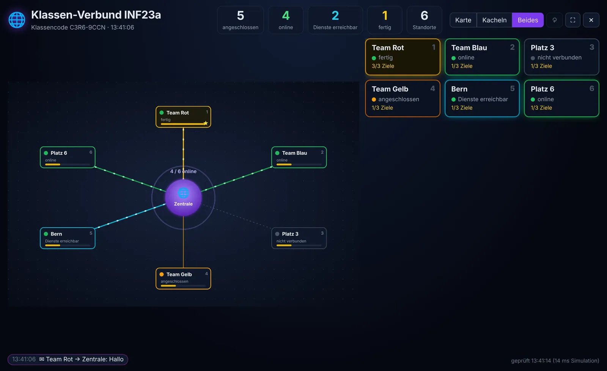
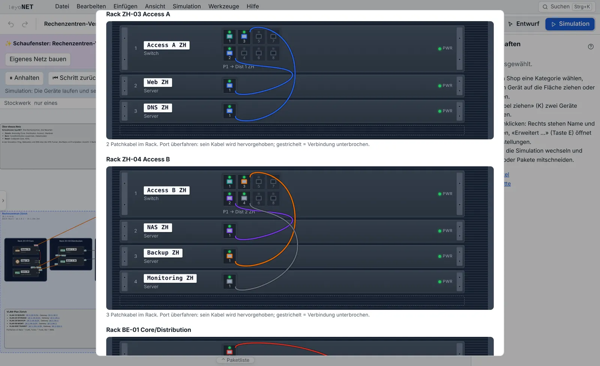

## leyoNET 1.5: Die ganze Klasse in einem Netz

Bisher baute jede Person ihr eigenes Netz. Mit Version 1.5 wächst daraus ein gemeinsames: Jede Gruppe baut ihren Standort, schliesst ihn an die Infrastruktur der Lehrperson an, und auf dem Beamer leuchtet live auf, wer wirklich online ist. Dazu kommen ein **Schaufenster** mit drei verbundenen Rechenzentren, ein **Wiki** mit Crashkurs und Theorie, eigene **Zugänge für Schulen** und viel Arbeit an Sicherheit und Datenschutz.

Version 1.5 enthält alles, was für 1.4 geplant war. Die Version 1.4 wurde nie fertig veröffentlicht; wer 1.3 hat, bekommt mit 1.5 beides.

### Auf einen Blick

| | Neu |
|---|---|
| 🏫 **Klassen-Verbund** | Standorte der Lernenden an einer gemeinsamen Infrastruktur, ein Netz für alle |
| 📺 **Dashboard** | Karte und Kacheln für den Beamer, ehrlich per Ping geprüft |
| 🏢 **Schaufenster** | Drei Rechenzentren mit Racks, VLANs, IPsec und DNS, läuft von selbst |
| 📖 **Wiki** | [leyonet.ch/wiki](https://leyonet.ch/wiki/) mit Crashkurs, Theorie, Geräten und Normen, mit Bildern und Animationen |
| 🔑 **Zugänge** | Für Schulen und Lehrpersonen, ohne Namen oder E-Mail-Adressen |
| 🛡️ **Sicherheit** | Über 100 Angriffe auf den Server vor jedem Release, Live-Prüfung der Seiten |

### Downloads

| System | Datei |
|---|---|
| Windows | `leyoNET-Windows-Setup.exe` (oder `leyoNET-Windows.msi`) |
| macOS (Intel und Apple Silicon) | `leyoNET-macOS.dmg` |
| Linux | `leyoNET-Linux.AppImage`, `leyoNET-Linux.deb` oder `leyoNET-Linux.rpm` |
| Ohne Installation | `leyonet.html` (eine Datei, läuft offline im Browser) |
| Arbeitsblätter | `leyoNET-Arbeitsblaetter.zip` (alle PDFs für Lernende) |

Prüfsummen: `SHA256SUMS.txt`. Im Browser: [app.leyonet.ch](https://app.leyonet.ch). Die Installer sind nicht signiert; Windows (SmartScreen) und macOS fragen beim ersten Start nach, siehe [docs/desktop.md](https://github.com/vonam-git/leyoNET/blob/main/docs/desktop.md).

### 🏫 Klassen-Verbund (Webversion)

- **Eigener Standort:** Lernende treten der Klasse mit **Platznummer** und optional einer **Gruppe** bei (z.B. «Team Rot», keine Personennamen). Modem, Internet-Box, Router oder Firewall wird zum Anschluss an die Klassen-Infrastruktur; «Adressen eintragen» setzt WAN-Adresse (eigenes /30-Transfernetz je Platz), Standardroute und NAT.
- **Ein Netz für alle:** Die Simulation im Browser rechnet das eigene Netz zusammen mit der Infrastruktur und, falls freigegeben, den anderen Standorten. Gespeichert wird nur das eigene Netz.
- **Infrastruktur mit einem Klick:** Vorlage mit Provider und Zentrale (Webserver), oder ein eigenes Netz der Lehrperson übernehmen.
- **Dashboard für den Beamer:** Karte mit leuchtenden Verbindungen, Kacheln oder beides, Vollbild, Ticker mit Statuswechseln und Nachrichten. Die Stufen (nicht verbunden, angeschlossen, online, Dienste erreichbar, fertig) prüft das Dashboard ehrlich per Ping und Webseite von der Zentrale aus. Ein Klick auf einen Standort schaut ihm zu.
- **Nachrichten** zwischen Standorten, an die Zentrale oder an alle. Sie gehen nur weg, wenn der eigene Standort die Zentrale wirklich erreicht, und fliegen als Lichtpunkt über die Karte.
- **Verbund-Übungen** («Standort an die Zentrale anschliessen», «Eigenen Webserver im Verbund veröffentlichen») mit dem neuen Prüfbaustein «Standort im Verbund erreichbar», dazu die Demo «Klassen-Verbund» mit Führung.
- Anleitung: [docs/verbund.md](https://github.com/vonam-git/leyoNET/blob/main/docs/verbund.md).

### 🏢 Schaufenster: Rechenzentren im Verbund

- **Neue Demo «Rechenzentren-Verbund»:** drei Standorte (Zürich, Bern, Basel), über Modems und Provider verbunden, mit Racks, Core- und Access-Switches, farbigen VLANs (Server, Storage, Backup, Management, Transit), IPsec zwischen allen Standorten und DNS unter `rz.example`.
- **Schaufenster-Modus:** [app.leyonet.ch/?schaufenster](https://app.leyonet.ch/?schaufenster) zeigt das Netz bildschirmfüllend, die Abläufe laufen von selbst in Schlaufe. Ideal für den Infotag, den Beamer im Schulzimmer oder einen Bildschirm im Gang. Es wird nichts gespeichert; «Eigenes Netz bauen» führt in den normalen Simulator.
- Mit `?schaufenster=<demo>` läuft jede andere der 37 Demos als Schaufenster.

### 📖 Wiki und Dokumentation

- **[leyonet.ch/wiki](https://leyonet.ch/wiki/):** Crashkurs für Lehrpersonen, Theorie mit Beispielen und den zugehörigen Normen, eine Seite je Gerät, Protokoll und Demo, Übungskatalog und Suche. Alles statisch, ohne Cookies und ohne fremde Server.
- **Bilder und Animationen:** Jede Demo hat ihr Bildschirmfoto im Wiki (hell und dunkel), wichtige Abläufe wie ARP, DHCP, NAT, VPN, OSPF oder ein Broadcast-Sturm laufen als Animation in Zeitlupe. Wer im Betriebssystem «Bewegung reduzieren» eingestellt hat, sieht ein Standbild.
- **Neues README** mit Bildern statt langer Texte.
- **Doku-Prüfung bei jedem Release:** Ein Test prüft Verweise, Zahlen, Versionen und die Hilfe; eine Liste in [docs/doku-pruefung.md](https://github.com/vonam-git/leyoNET/blob/main/docs/doku-pruefung.md) deckt den Rest ab.

### 🔑 Admin-Konsole

- **Eigene Zugänge für Schulen und Lehrpersonen:** Bezeichnung plus Zugangsschlüssel, ohne Namen oder E-Mail-Adressen. Gespeichert ist nur eine Prüfsumme des Schlüssels. Jeder Zugang sieht nur seine Klassen und Prüfungen, eine Schule auch die ihrer Lehrpersonen.
- **Aufgaben ein- und ausblenden:** einzelne Übungen, ganze Module (Reihen) und die Verbund-Aufgaben, für die ganze Instanz und zusätzlich je Klasse.
- Sessions der Klasse mit Standort, Fortschritt und «gerade offen».

### 🛡️ Sicherheit

- **Codes raten gebremst:** Session- und Platz-Codes lassen sich nicht mehr hundertfach pro Minute ausprobieren (höchstens 30 Fehlversuche je Adresse und Minute).
- **Angriffe bei jedem Release:** Ein Prüfskript greift den Server vor jeder Version von aussen an, mit über 100 Prüfungen: Pfad-Tricks, CORS, CSRF, Injection, Prototype Pollution, fremde Sessions, Raten, Last, Trennung der Zugänge, Nachrichten im Verbund und mehr.
- **Live-Prüfung:** Wöchentlich und nach jedem Release prüft ein Workflow app.leyonet.ch, beta.leyonet.ch und leyonet.ch (TLS, HTTPS, Sicherheitsköpfe, versteckte Dateien) und meldet Befunde als Issue.
- **Sicherheitslücken melden:** `SECURITY.md` und `/.well-known/security.txt` (RFC 9116), vertraulich über GitHub.

### 🔒 Datenschutz für Schulen

- **ISDS-Konzept** ([docs/isds-konzept.md](https://github.com/vonam-git/leyoNET/blob/main/docs/isds-konzept.md)): Daten, Schutzbedarf, rechtliche Einordnung, Risiken, Massnahmen, Restrisiken und Einsatzentscheid der Schule.
- **DSFA-Abklärung** ([docs/dsfa-abklaerung.md](https://github.com/vonam-git/leyoNET/blob/main/docs/dsfa-abklaerung.md)): Schwellwertanalyse nach DSG und kantonalen Kriterien. Ergebnis: kein hohes Risiko unter klaren Bedingungen.
- Zugänge sind keine Benutzerkonten; Verbund-Nachrichten liegen nur 30 Minuten im Arbeitsspeicher.

### 🌗 Website und Kontakt

- **leyonet.ch hell und dunkel**, mit neuen Bildschirmfotos aus Version 1.5 und Reitern für Rechenzentrum und Racks.
- **Kontakt:** Ein Formular im Impressum bereitet die E-Mail im eigenen E-Mail-Programm vor. Die Website speichert und überträgt dabei nichts.

### ❤️ leyoNET unterstützen

leyoNET bleibt frei und quelloffen, ohne Werbung und ohne Tracking. Wer die Weiterentwicklung unterstützen möchte, findet uns auf **[Patreon](https://www.patreon.com/cw/vonam)**. Der Link steht jetzt auch im Programm unter *Hilfe → leyoNET unterstützen* und im Fenster «Über». Er öffnet nur die Seite im Browser; leyoNET selbst verbindet sich nirgends hin.

### Für Betreiber der Webversion

Nach dem Update in Plesk die Node.js-App neu starten (der Server hat sich seit 1.3 geändert). Keine neuen Umgebungsvariablen. Zugänge liegen im Ordner `DATA_DIR/tenants`, er wird automatisch angelegt. Für leyonet.ch die neue Version von `website/httpdocs/` hochladen, inklusive Ordner `wiki/`. Wer ein eigenes Impressum betreibt: Die Vorlage `impressum.vorlage.html` hat neu ein Kontaktformular (Adresse in `data-user` und `data-domain` eintragen).
