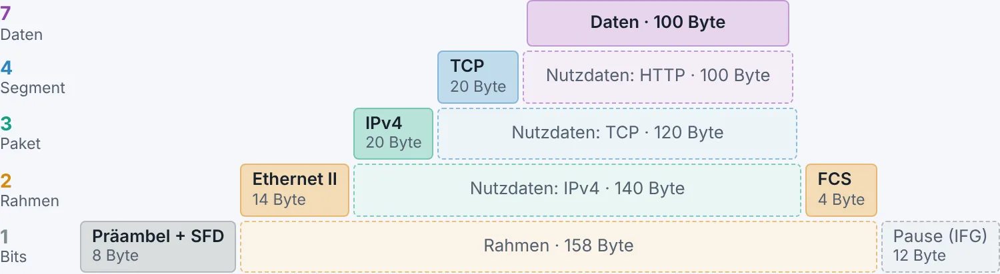

## leyoNET 1.5.1: Rahmen und Pakete nach Norm

Wie steckt eine HTTP-Anfrage in TCP, IP und Ethernet? Wo steht die TTL, wie viele Bit hat das Flow Label, und was macht die FCS am Ende des Rahmens? Version 1.5.1 zeigt es Feld für Feld, so wie die RFCs und IEEE-Normen es zeichnen, mit den echten Werten des angeklickten Rahmens. In der App und im Wiki sieht alles gleich aus: dieselben Farben der Schichten, dieselben Tags der Protokolle.

### Downloads

| System | Datei |
|---|---|
| Windows | `leyoNET-Windows-Setup.exe` (oder `leyoNET-Windows.msi`) |
| macOS (Intel und Apple Silicon) | `leyoNET-macOS.dmg` |
| Linux | `leyoNET-Linux.AppImage`, `leyoNET-Linux.deb` oder `leyoNET-Linux.rpm` |
| Ohne Installation | `leyonet.html` (eine Datei, läuft offline im Browser) |
| Arbeitsblätter | `leyoNET-Arbeitsblaetter.zip` (alle PDFs für Lernende) |

Prüfsummen: `SHA256SUMS.txt`. Im Browser: [app.leyonet.ch](https://app.leyonet.ch). Die Installer sind nicht signiert; siehe [docs/desktop.md](https://github.com/vonam-git/leyoNET/blob/main/docs/desktop.md).

### 🧱 Ethernet mit FCS

- **Jeder Ethernet-Rahmen endet jetzt mit seiner Prüfsumme FCS** (CRC-32 nach IEEE 802.3). Kurze Rahmen wie ARP-Anfragen werden mit Nullen auf die Mindestlänge von 64 Byte aufgefüllt. Präambel, SFD und Pause stehen auf Schicht 1.
- WLAN-Rahmen tragen ebenfalls eine CRC-32, PPP auf seriellen Leitungen eine FCS-16 (RFC 1662). Zahlen im WLAN-Kopf stehen wie in IEEE 802.11 mit dem niederwertigsten Byte zuerst.
- Der **pcapng-Export** sagt Wireshark, dass die 4 Byte FCS dabei sind.
- Arbeitsblatt M129 «Protokollanalyse»: Der Rahmen der DNS-Anfrage hat jetzt 81 statt 77 Byte, mit eigener Zeile für die FCS.

### 🔍 Aufbau nach Norm in den Paketdetails

- Unter jeder Schicht öffnet **«Aufbau nach Norm»** den Kopf als Bild: als Raster mit 32 Bit je Zeile wie in den RFCs (IPv4, IPv6, TCP, UDP, ICMP, ARP, 802.1Q) oder als Band von links nach rechts wie in IEEE 802.3 (Ethernet II, 802.3 mit LLC/SNAP, WLAN, PPP). Darin stehen die **Werte des angeklickten Rahmens**; zeigen auf ein Feld erklärt es.
- **Verschachtelung**: Die Schichten als Treppe, mit Kopf, Nutzdaten und FCS und ihren Längen in Byte.
- Neuer Funktionsschalter «Aufbau der Rahmen» (ab Profil 2).

### 📖 Wiki: Aufbau von Rahmen und Paketen

- **Neue Seite** [Aufbau von Rahmen und Paketen](https://leyonet.ch/wiki/rahmen-und-pakete.html): Verschachtelung zum Durchklicken («Nächste Hülle einpacken»), ein Rahmen wie in der Paketliste mit Hex-Ansicht, jeder Kopf mit Feldtabelle, Grössen und Prüfsummen auf einen Blick.
- **OSI-Modell** mit den Farben der App und allen simulierten Protokollen als Tags.
- Die Seiten zu Ethernet, VLAN, ARP, STP, WLAN, PPP, IPv4, IPv6, ICMP, TCP und UDP zeigen ihren Kopf nach Norm.
- Alle Beispiele sind **echte Rahmen aus den Demo-Netzen**, so wie leyoNET sie zeigt. Ein Test vergleicht die Bilder mit den Bytes, damit Wiki und App nie auseinanderlaufen.

### Für Betreiber der Webversion

Keine Änderung am Server, keine neuen Einstellungen. Für leyonet.ch die neue Version von `website/httpdocs/` hochladen (Ordner `wiki/` mit den neuen Dateien `farben.css` und `aufbau.css`).
